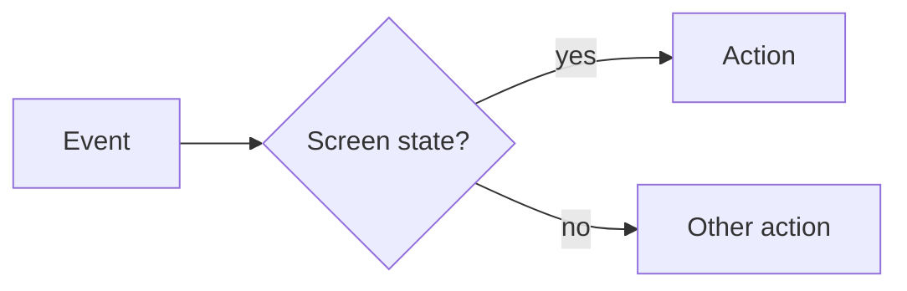

# UI ticket template

Use this skeleton for any ticket that changes user-facing interaction in `reid-ui`
(flows, screens, cards, buttons, toasts, defaults). Copy it into a new ticket at
`.scratch/<feature-slug>/issues/<NN>-<slug>.md` and fill in the sections. Delete
sections that don't apply rather than leaving them empty.

Standing user preferences live in **`docs/ui-learnings.md`** — check it first and
reference the learnings you apply (e.g. "plain language, no jargon").

```markdown
# <Title>

Part of: [map](../map.md)
Type: prototype | grilling | task
Status: ready-for-agent

## Question

One paragraph: what should the user be able to do / see that they can't today?

## Screens / flows

One subsection per screen. For each: states shown, entry points, actions with
their exact semantics, and what data each element shows.

### Screen: <name>
- State: ...
- Entry: tab click | restored from localStorage after refresh | after <action>
- Actions:
  - "<button label>" → <what happens, which API, which semantics: pin-for-next-run vs write-now>
- Card/row: <image behavior, overlay, checkbox default, chips>
- Edge cases: run active → ...; core down → ...; empty → ...

## Flow diagram



## Visuals

- Penpot design: <link or "none — small change">
- Runnable prototype: branch `prototype/<name>`, open `prototype/<name>.html` in a
  browser; variants via `?variant=A|B`. Verdict goes in Comments, then Status: resolved.

## Copy rules

Plain language, no jargon (see docs/ui-learnings.md). Button labels state the
semantics ("Pin as X for next run…" vs "Write as X"). Every action gets a toast
restating what happened.

## Behavior tests

Encode the decided behaviors in `tests/ui/app.test.mjs` (jsdom) — one test per
decided rule (default-off, hidden-by-default + toggle, button state matches the
write path, semantics labels, tab persistence across refresh, etc.).
```

## Workflow

1. **Visuals first if interaction is non-trivial**: Penpot for layout, or a
   runnable HTML prototype on a throwaway branch (`prototype/<name>`) — react to
   it in a real browser, iterate, then record the verdict in the ticket.
2. **Fill the ticket**: screens/flows, mermaid diagram, edge cases, copy rules.
3. **Grill it** (`grilling` skill) before building — user interaction decisions are
   cheapest to change here.
4. **Build against the ticket**; add the jsdom tests from the "Behavior tests"
   section so the decided interaction stays enforced in CI.
5. On resolve: append the answer under `## Answer`, set `Status: resolved`, and
   link the ticket from the map's Decisions-so-far. If the ticket produced new
   standing user preferences, add them to `docs/ui-learnings.md`.
